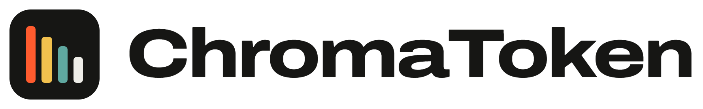
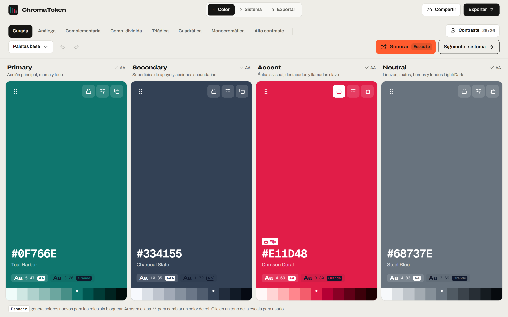
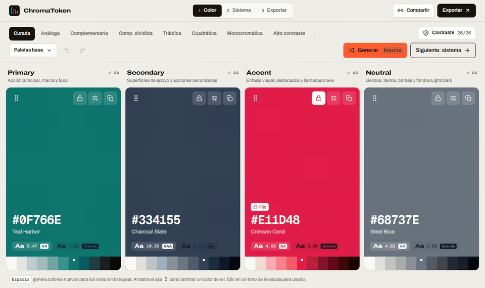
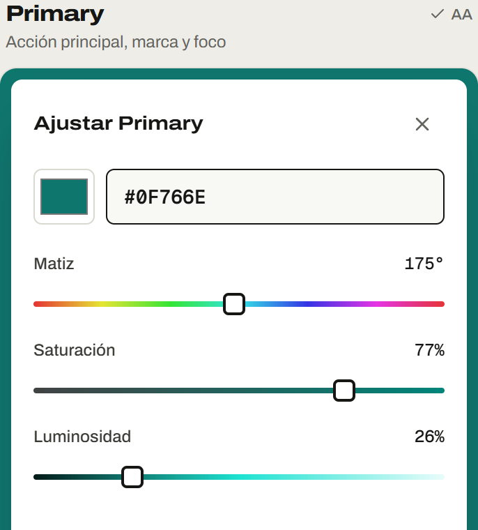
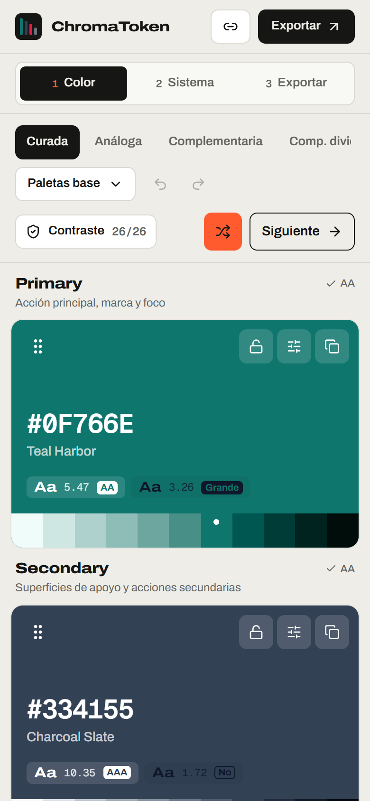
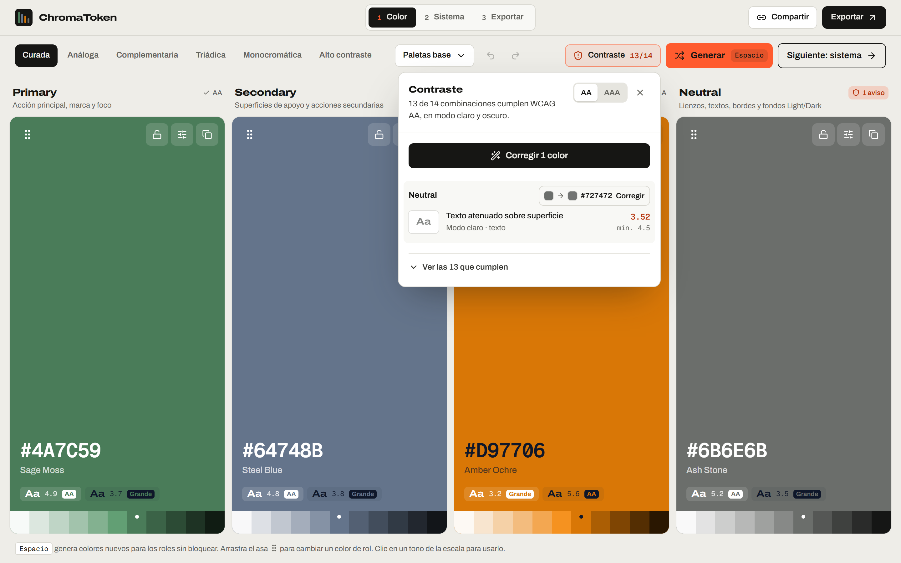
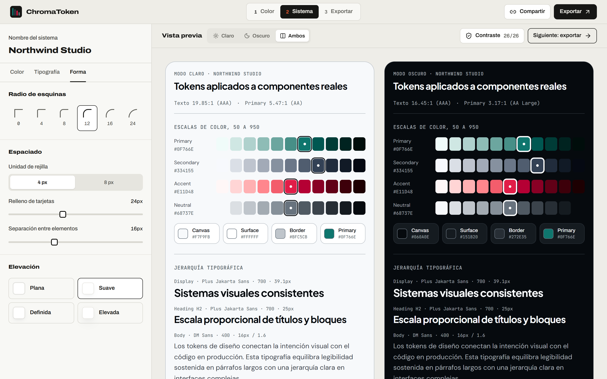
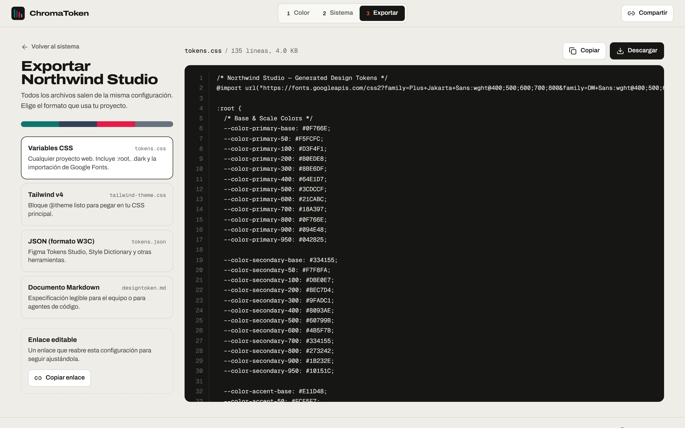

<p align="center">
  <picture>
    <source media="(prefers-color-scheme: dark)" srcset="docs/assets/logo-dark.png">
    
  </picture>
</p>

<p align="center">
  <strong>From a color palette to a production-ready design system.</strong><br>
  Generate colors by role, check contrast, configure typography and shape, and export design tokens to code and Figma.
</p>

<p align="center">
  
  
  
  
  
</p>

<p align="center">
  <a href="#what-you-can-do">What you can do</a> ·
  <a href="#import-design-tokens-into-figma">Figma</a> ·
  <a href="#getting-started">Getting started</a> ·
  <a href="#project-structure">Project structure</a> ·
  <a href="#credits">Credits</a> ·
  <a href="README.md" lang="es">README en español</a>
</p>

<p align="center">
  
</p>

---

ChromaToken runs entirely in your browser. Your workspace stays on your device.

The interface is available in Spanish and English. ChromaToken follows your browser or device language preferences and defaults to Spanish when none of those languages is supported.

## What you can do

### 1 · Color

<p align="center">
  
</p>

- **Generate** palettes in the perceptual **OKLCH** color space. Press Space to use the selected harmony rule. Choose from curated, analogous, complementary, split complementary, triadic, tetradic, monochromatic, and high-contrast palettes.
- **Lock** the colors you want to keep and generate new colors for the remaining roles.
- **Drag** a color between roles (Primary, Secondary, Accent, Neutral) with the ⋮⋮ handle. The controls support a mouse, touch, and keyboard.
- **Adjust** hue, saturation, and lightness or choose a shade from the 50–950 scale.
- Start from a **palette preset**, and **undo or redo** changes to colors, locks, typography, and geometry.

<table>
  <tr>
    <td width="50%" valign="top">
      
      <p align="center"><sub>Fine-tune hue, saturation, and lightness</sub></p>
    </td>
    <td width="50%" valign="top" align="center">
      
      <p align="center"><sub>ChromaToken on a mobile screen</sub></p>
    </td>
  </tr>
</table>

### Contrast checks

<p align="center">
  
</p>

ChromaToken checks the color combinations your system uses in both light and dark modes against WCAG 2.2.

- Text on primary, secondary, and accent buttons.
- The primary color used for focus indicators, icons, and active borders.
- Main, secondary, and muted text on the canvas, raised surfaces, and muted surfaces, along with field and control borders.
- Status messages (`success`, `warning`, and `destructive`) on their backgrounds.

Text targets a contrast ratio of **4.5:1** at level AA or **7:1** at level AAA. UI elements and borders target **3:1**.

- The palette generator leaves OKLCH hues intact and checks contrast in real time.
- When a combination fails, the contrast panel suggests a minimal lightness adjustment for unlocked roles.
- Use **Fix** to apply the suggestion. You can undo the change or fix locked colors individually.

### 2 · System

<p align="center">
  
</p>

- **Typography** starts from a curated Google Fonts pairing or individual fonts for headings, body text, and code. Adjust weight, base size, scale ratio, line height, and heading letter spacing.
- **Shape** covers corner radius, grid units, card padding, element gaps, and elevation.
- **Preview** shows components and six web or mobile app templates that use the 60/30/10 color rule. View light and dark modes individually or compare them together.

### 3 · Export

<p align="center">
  
</p>

| File | Use |
| --- | --- |
| `tokens.css` | CSS variables with `:root`, `.dark`, and a Google Fonts import |
| `tailwind-theme.css` | An `@theme` block for Tailwind CSS v4 |
| `tokens.json` | W3C Design Tokens format for tools such as Style Dictionary |
| `tokens.md` | A readable design specification with contrast results for teammates or coding agents |
| `Light.json` + `Dark.json` | Native Figma variables with light and dark modes and palette aliases |
| `tokens-studio.json` | A Tokens Studio package with variables, composite typography, and shadows |

**Share** copies a link that reopens the current configuration.

### Import design tokens into Figma

The export panel includes instructions for both import methods.

| | Figma variables | Tokens Studio |
| --- | --- | --- |
| Files | `Light.json` + `Dark.json` | `tokens-studio.json` |
| Requirement | Figma Professional or higher | [Tokens Studio for Figma](https://www.figma.com/community/plugin/843461159747178978) |
| Light and dark colors | Yes | One collection on a paid plugin plan, two on the free plan |
| Sizes, radii, and spacing | Yes | Yes |
| Display, H1–H3, Body, Small, and Code styles | No | Yes |
| sm, md, and lg shadows | No | Yes |

Semantic colors such as `text`, `surface`, and `primary` become **palette aliases** when they match a shade, so editing the palette in Figma updates those variables. Colors adjusted by the contrast engine keep their direct values.

**Figma variables**

1. Select **Download all** to get both files.
2. In Figma, deselect everything, open **Local variables**, and create a collection.
3. Drag `Light.json` and `Dark.json` into the variables window together. Each file creates a mode.
4. To update a mode, right-click it and choose **Import mode**.

**Tokens Studio**

1. Open the plugin and choose **Load and export** → **Load from file/folder** → **Choose file**. Select `tokens-studio.json`.
2. Choose **Styles & Variables** → **Export styles & variables** and select variables and styles.

The file uses the W3C DTCG format, which the plugin uses by default.

### Keyboard shortcuts

| Shortcut | Action |
| --- | --- |
| <kbd>Space</kbd> | Generate a new palette |
| <kbd>Ctrl</kbd>/<kbd>Cmd</kbd> + <kbd>Z</kbd> | Undo |
| <kbd>Ctrl</kbd>/<kbd>Cmd</kbd> + <kbd>Shift</kbd> + <kbd>Z</kbd> or <kbd>Ctrl</kbd> + <kbd>Y</kbd> | Redo |
| <kbd>Space</kbd> → arrow keys → <kbd>Space</kbd> with the handle focused | Move a color to another role |
| <kbd>Esc</kbd> | Close panels |

## Getting started

You need **Node.js 20.19+ or 22.12+** and npm.

```bash
git clone https://github.com/guillermo259/chromatoken.git
cd chromatoken
npm install
npm run dev
```

The app runs at `http://localhost:3000`.

| Command | Use |
| --- | --- |
| `npm run dev` | Start the development server on port 3000 |
| `npm run build` | Create a production build in `dist/` |
| `npm run preview` | Serve the production build locally |
| `npm run lint` | Run the TypeScript type check |

You can publish the static `dist/` directory to GitHub Pages, Netlify, Vercel, Cloudflare Pages, or another static host.

## Technology

| Area | Technology |
| --- | --- |
| Interface | [React 19](https://react.dev) and [TypeScript](https://www.typescriptlang.org) |
| Build | [Vite](https://vite.dev) |
| Styles | [Tailwind CSS v4](https://tailwindcss.com) |
| Drag and drop | [dnd-kit](https://dndkit.com) |
| Icons | [Lucide](https://lucide.dev) |
| Fonts | [Google Fonts](https://fonts.google.com), including Archivo and Geist Mono for the interface |

## Project structure

```text
src/
├── App.tsx                        Workspace state, undo history, and step navigation
├── components/
│   ├── TopBar.tsx                 Step navigation and sharing
│   ├── PaletteBoard.tsx           Color roles, palettes, drag and drop, and HSL editing
│   ├── StudioSidebar.tsx          Color, Typography, and Shape controls
│   ├── PreviewCanvas.tsx          Preview layout, formats, and light and dark modes
│   ├── VisualShowcaseSurface.tsx  Component previews
│   ├── InterfacePreview.tsx       Web and mobile app templates
│   ├── ExportPanel.tsx            Formats, code preview, and Figma import guides
│   ├── ContrastPanel.tsx          Contrast indicator and audit results
│   ├── Toast.tsx                  Brief notifications
│   └── Footer.tsx                 Credits and repository link
├── i18n/                          Language detection and English copy
├── utils/
│   ├── colorEngine.ts             Color conversion, scales, harmonies, and semantic themes
│   ├── contrastAudit.ts           WCAG checks and lightness adjustments
│   ├── figmaExporters.ts          Native variables and Tokens Studio formats
│   └── tokenExporters.ts          CSS, Tailwind, JSON, Markdown, and shared links
├── data/googleFonts.ts            Font catalog and curated pairings
└── types/tokens.ts                Shared types
```

## Privacy

Your configuration is saved in your browser's `localStorage`. Shared links encode the configuration in the URL fragment, so it stays in the browser. The app loads fonts from Google Fonts.

## Documentation

- [Interface and experience redesign](docs/REDISENO-UI-UX.md) (Spanish)

## Credits

ChromaToken was made by:

<table>
  <tr>
    <td align="center" width="160">
      <a href="https://github.com/guillermo259">
        <br>
        <sub><b>@guillermo259</b></sub>
      </a>
    </td>
    <td align="center" width="160">
      <a href="https://github.com/lorspi">
        <br>
        <sub><b>@lorspi</b></sub>
      </a>
    </td>
  </tr>
</table>
