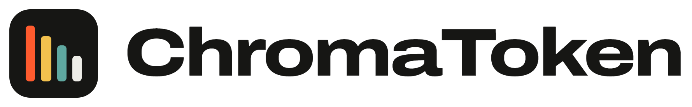
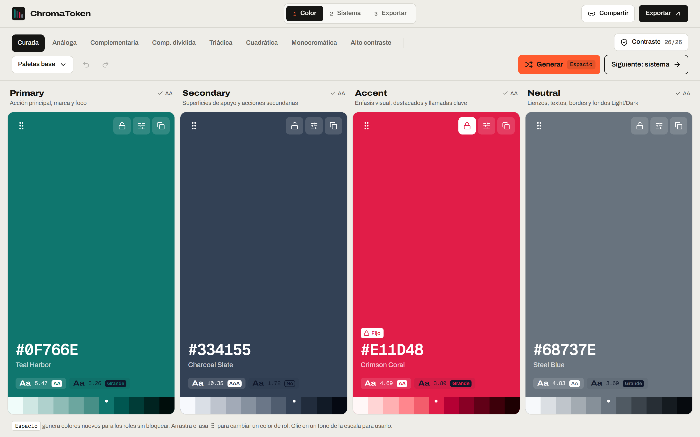
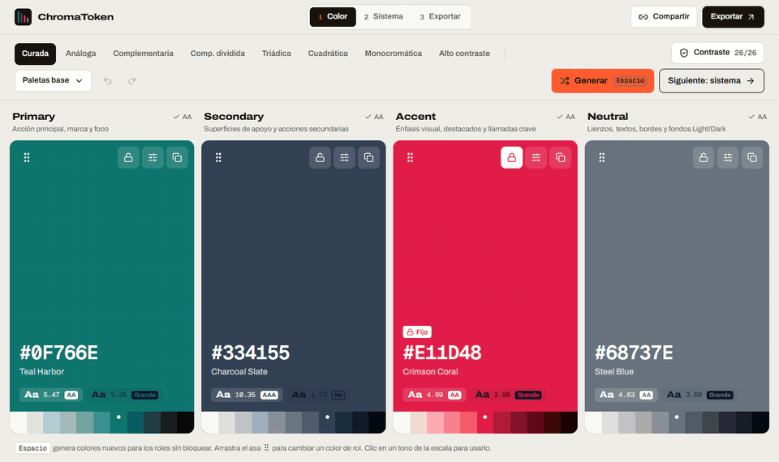
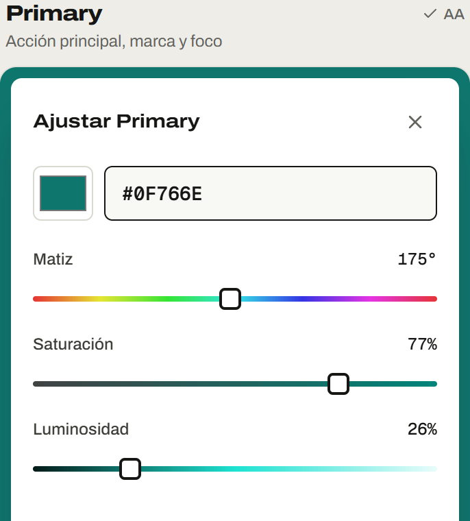
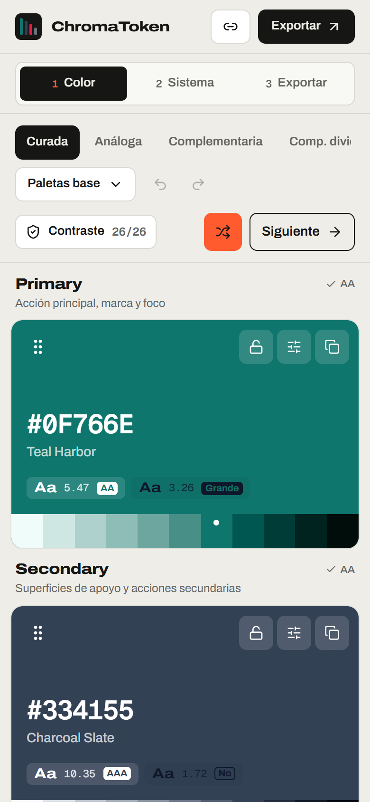
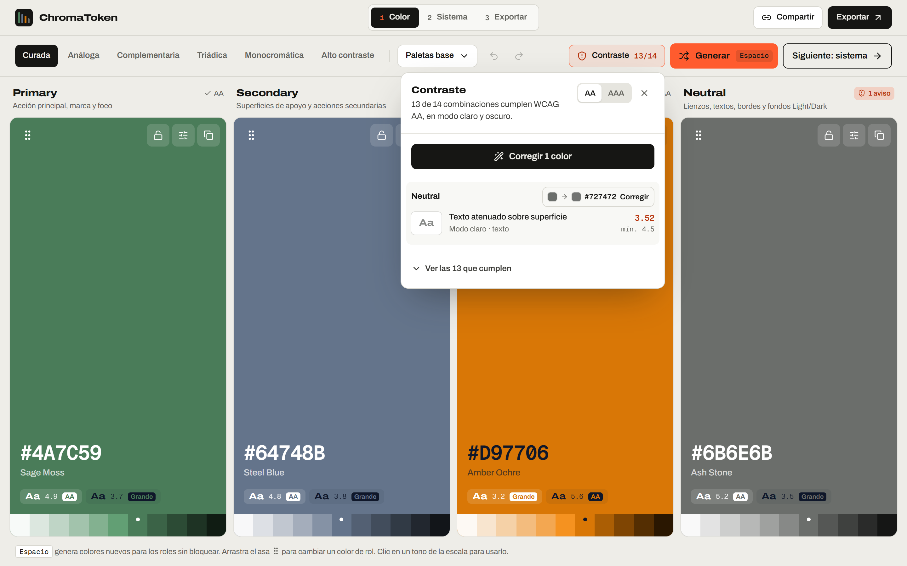
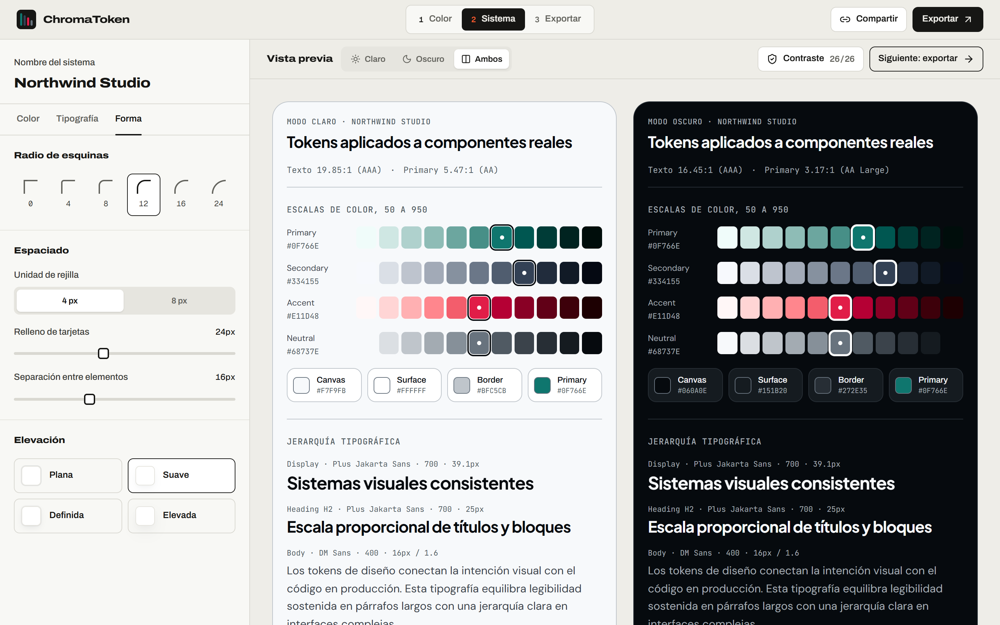
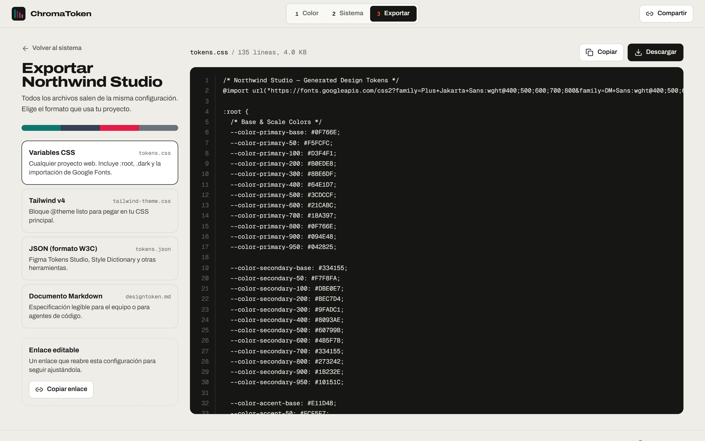

<p align="center">
  <picture>
    <source media="(prefers-color-scheme: dark)" srcset="docs/assets/logo-dark.png">
    
  </picture>
</p>

<p align="center">
  <strong>De una paleta de color a un sistema de diseño listo para producción.</strong><br>
  Genera colores con roles, valida su contraste, define tipografía y forma, y exporta tus design tokens a código y a Figma.
</p>

<p align="center">
  
  
  
  
  
</p>

<p align="center">
  <a href="#qué-puedes-hacer">Qué puedes hacer</a> ·
  <a href="#llevar-los-tokens-a-figma">Figma</a> ·
  <a href="#puesta-en-marcha">Puesta en marcha</a> ·
  <a href="#estructura">Estructura</a> ·
  <a href="#créditos">Créditos</a> ·
  <a href="README.en.md" lang="en">English README</a>
</p>

<p align="center">
  
</p>

---

Todo corre en el navegador: no hay servidor, no hay cuentas y no se envían datos a ningún sitio.

La interfaz está disponible en español e inglés. ChromaToken sigue las preferencias de idioma del dispositivo o navegador y usa el español cuando ninguno de los idiomas preferidos está disponible.

## Qué puedes hacer

### 1 · Color

<p align="center">
  
</p>

- **Genera** paletas en espacio perceptual **OKLCH** con la barra espaciadora, siguiendo una regla de armonía: curada, análoga, complementaria, complementaria dividida, triádica, cuadrática, monocromática o alto contraste.
- **Bloquea** los colores que quieras conservar. Generar solo cambia los demás.
- **Arrastra** un color de un rol a otro (Primary, Secondary, Accent, Neutral) con el asa ⋮⋮. Funciona con ratón, con pantalla táctil y con teclado.
- **Ajusta** cada color por matiz, saturación y luminosidad, o elige un tono de su escala monótona 50–950.
- Parte de una de las **paletas base**, y **deshaz o rehaz** cualquier cambio (colores, bloqueos, tipografía o geometría).

<table>
  <tr>
    <td width="50%" valign="top">
      
      <p align="center"><sub>Ajuste fino por matiz, saturación y luminosidad</sub></p>
    </td>
    <td width="50%" valign="top" align="center">
      
      <p align="center"><sub>También funciona en el móvil</sub></p>
    </td>
  </tr>
</table>

### Contraste validado

<p align="center">
  
</p>

ChromaToken no compara cada color con blanco y negro: revisa las **combinaciones que tu sistema usa de verdad**, en modo claro y en modo oscuro, contra WCAG 2.2.

- Texto sobre los botones primario, secundario y de acento.
- El primario usado como foco, icono o borde activo.
- El texto principal, el secundario y el atenuado sobre el fondo, la superficie elevada y la superficie atenuada, y el borde de campos y controles (`3:1` WCAG 1.4.11).
- Los avisos de estado (`success`, `warning` y `destructive`) sobre sus respectivos fondos, calibrados según el nivel AA o AAA.

El texto necesita **4.5:1** en nivel AA y **7:1** en nivel AAA. Los elementos de interfaz y bordes necesitan **3:1**.

- El generador prioriza la **libertad cromática** en OKLCH y audita cada combinación en tiempo real sin deformar los tonos al generar.
- Si alguna combinación falla en AA o AAA, el indicador de contraste avisa y propone el ajuste mínimo de luminosidad para los roles desbloqueados.
- Los colores **bloqueados nunca se cambian solos**.
- **Corregir** aplica la propuesta con un clic, y se puede deshacer.

### 2 · Sistema

<p align="center">
  
</p>

- **Tipografía:** combinaciones curadas de Google Fonts, o fuentes elegidas una a una para títulos, texto y código, con peso, tamaño base, proporción de escala, interlineado y espaciado de títulos.
- **Forma:** radio de esquinas, unidad de rejilla, relleno de tarjetas, separación entre elementos y estilo de elevación.
- **Vista previa:** explora componentes y seis plantillas en formato web o app móvil, con la regla de color 60/30/10. Compara los modos claro y oscuro.

### 3 · Exportar

<p align="center">
  
</p>

| Archivo | Para qué sirve |
| --- | --- |
| `tokens.css` | Variables CSS con `:root`, `.dark` y la importación de Google Fonts |
| `tailwind-theme.css` | Bloque `@theme` para Tailwind CSS v4 |
| `tokens.json` | Formato W3C Design Tokens (Style Dictionary) |
| `tokens.md` | Especificación legible para el equipo o para agentes de código, con la tabla de contraste |
| `Light.json` + `Dark.json` | Variables nativas de Figma con modos claro/oscuro y alias a la paleta |
| `tokens-studio.json` | Paquete completo para Tokens Studio (variables, tipografías compuestas y sombras) |

**Compartir** copia un enlace que reabre exactamente la misma configuración.

### Llevar los tokens a Figma

Hay dos formas, y el panel de exportación muestra la guía de importación de cada una:

| | Variables de Figma | Tokens Studio |
| --- | --- | --- |
| Archivos | `Light.json` + `Dark.json` | `tokens-studio.json` |
| Necesita | Plan Professional o superior de Figma | El plugin [Tokens Studio for Figma](https://www.figma.com/community/plugin/843461159747178978) |
| Colores con modos claro y oscuro | Sí | Sí. Juntos en una colección con el plan de pago del plugin; con el gratuito, en dos colecciones |
| Tamaños, radios y espaciado | Sí | Sí |
| Estilos de texto (Display, H1–H3, Body, Small, Code) | No | Sí |
| Sombras sm, md y lg | No | Sí |

Los colores semánticos (`text`, `surface`, `primary`…) quedan como **alias de la paleta** cuando coinciden con un tono de la escala, así que al cambiar la paleta en Figma se actualizan solos. Los que el motor ajustó por contraste se exportan con su valor directo.

**Variables de Figma (sin plugins)**

1. Descarga los dos archivos con **Descargar todos**.
2. En Figma, sin nada seleccionado, abre **Local variables** y crea una colección nueva.
3. Arrastra `Light.json` y `Dark.json` juntos a la ventana de variables. Cada archivo crea un modo.
4. Para actualizar, haz clic derecho sobre un modo y elige **Import mode**.

**Tokens Studio**

1. Abre el plugin y pulsa **Load and export** → **Load from file/folder** → **Choose file**, y elige `tokens-studio.json`.
2. Pulsa **Styles & Variables** → **Export styles & variables** y marca variables y estilos.

El plugin viene configurado con el formato W3C DTCG, que es el que usa el archivo.

### Atajos de teclado

| Atajo | Acción |
| --- | --- |
| <kbd>Espacio</kbd> | Generar una paleta nueva |
| <kbd>Ctrl</kbd>/<kbd>Cmd</kbd> + <kbd>Z</kbd> | Deshacer |
| <kbd>Ctrl</kbd>/<kbd>Cmd</kbd> + <kbd>Shift</kbd> + <kbd>Z</kbd> · <kbd>Ctrl</kbd> + <kbd>Y</kbd> | Rehacer |
| <kbd>Espacio</kbd> → flechas → <kbd>Espacio</kbd> (con el asa enfocada) | Mover un color a otro rol |
| <kbd>Esc</kbd> | Cerrar paneles |

## Puesta en marcha

Requisitos: **Node.js 20.19+ o 22.12+** y npm.

```bash
git clone https://github.com/guillermo259/chromatoken.git
cd chromatoken
npm install
npm run dev
```

La app queda en `http://localhost:3000`.

| Comando | Qué hace |
| --- | --- |
| `npm run dev` | Servidor de desarrollo en el puerto 3000 |
| `npm run build` | Build de producción en `dist/` |
| `npm run preview` | Sirve el build de producción en local |
| `npm run lint` | Comprobación de tipos con TypeScript |

El resultado de `npm run build` es estático: `dist/` se puede publicar en cualquier hosting de archivos (GitHub Pages, Netlify, Vercel, Cloudflare Pages…).

## Tecnología

| | |
| --- | --- |
| Interfaz | [React 19](https://react.dev) · [TypeScript](https://www.typescriptlang.org) |
| Build | [Vite](https://vite.dev) |
| Estilos | [Tailwind CSS v4](https://tailwindcss.com) |
| Arrastrar y soltar | [dnd-kit](https://dndkit.com) |
| Iconos | [Lucide](https://lucide.dev) |
| Tipografías | [Google Fonts](https://fonts.google.com): Archivo y Geist Mono en la interfaz, más las del catálogo para tu sistema |

## Estructura

```
src/
├── App.tsx                        Estado, historial y navegación entre pasos
├── components/
│   ├── TopBar.tsx                 Cabecera con los pasos y Compartir
│   ├── PaletteBoard.tsx           Paso 1: roles, tarjetas, arrastrar y soltar, ajuste HSL
│   ├── StudioSidebar.tsx          Paso 2: pestañas Color, Tipografía y Forma
│   ├── PreviewCanvas.tsx          Paso 2: vista previa en claro, oscuro y ambos
│   ├── VisualShowcaseSurface.tsx  Componentes de muestra pintados con tus tokens
│   ├── InterfacePreview.tsx       Plantillas web y de app móvil
│   ├── ExportPanel.tsx            Paso 3: formatos, visor de código y guías para Figma
│   ├── ContrastPanel.tsx          Indicador y panel de contraste
│   ├── Toast.tsx                  Avisos breves
│   └── Footer.tsx                 Créditos y enlace al repositorio
├── i18n/                          Detección del idioma y textos en inglés
├── utils/
│   ├── colorEngine.ts             Conversión de color, escalas 50–950, armonías, tema semántico
│   ├── contrastAudit.ts           Auditoría WCAG y corrección por luminosidad
│   ├── figmaExporters.ts          Variables nativas de Figma y formato Tokens Studio
│   └── tokenExporters.ts          Generadores de CSS, Tailwind, JSON y Markdown; enlace compartido
├── data/googleFonts.ts            Catálogo de fuentes y combinaciones curadas
└── types/tokens.ts                Tipos compartidos
```

## Privacidad

La configuración se guarda solo en el `localStorage` de tu navegador. El enlace para compartir lleva la configuración codificada en la propia URL (después de `#`), así que no pasa por ningún servidor. Lo único que se descarga de terceros son las tipografías de Google Fonts.

## Documentación

- [Rediseño de interfaz y experiencia](docs/REDISENO-UI-UX.md): qué cambió y por qué.

## Créditos

ChromaToken es obra de:

<table>
  <tr>
    <td align="center" width="160">
      <a href="https://github.com/guillermo259">
        <br>
        <sub><b>@guillermo259</b></sub>
      </a>
    </td>
    <td align="center" width="160">
      <a href="https://github.com/lorspi">
        <br>
        <sub><b>@lorspi</b></sub>
      </a>
    </td>
  </tr>
</table>
